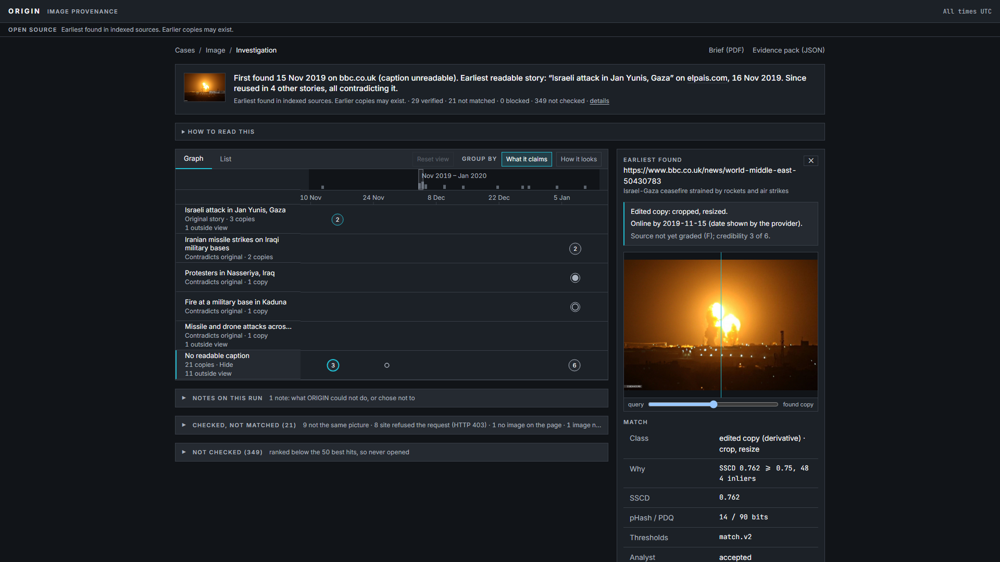

# ORIGIN

An image provenance tracer. Give it one image and it returns a dated, evidence-backed history: the earliest sighting found, every verified copy and edit, and the points where the story told about the image changes.

> Earliest found in indexed sources. Earlier copies may exist.

ORIGIN never reports an "origin". Private, deleted and unindexed posts are invisible to it, so every result is a bound, not a fact.

## Status

Built phase by phase

Phases 0 to 5 are built: ingest (hashes, metadata, Content Credentials, SSCD embedding), discovery through free-tier providers, verification of every hit by fetching and matching it, evidence-based dating, variants, claims, narratives and grades, the console with its timeline, variant graph, evidence drawer and exports, and Telegram behind a feature flag (below). Phase 6 has its matching eval, rate limits and end-to-end tests; the agent is not built.

## Run it

Requirements: Docker, [uv](https://docs.astral.sh/uv/), Node 22, GNU Make, and your own keys: copy `.env.example` to `.env` and set `SERPAPI_API_KEY` (Google Lens reverse search, free plan 250 searches a month) and `GEMINI_API_KEY` (reading claims from page text, free tier).

```sh
make dev       # db, redis, s3, migrate, api, worker, web; returns when all are healthy
```

| Service | URL |
| --- | --- |
| Console | http://localhost:3000 |
| API (OpenAPI docs at `/docs`) | http://localhost:8000 |
| Readiness | http://localhost:8000/readyz |

`make down` stops the stack and keeps its data volumes.

## Using it

Upload your own image to a case and start a trace. ORIGIN searches Google Lens, fetches each hit, keeps the ones that are your picture or an edit of it, dates them and reads the stories they tell. Pages that Google's redirect or a site's own block stops ORIGIN reaching are counted and listed, never dropped. **Trace again** reuses the stored search, so it costs no quota.



Open a case, then an image, then **Open investigation**. It starts with the answer in one sentence (where the earliest copy was found, when, and which story the original tells), then shows the copies as a **Graph** or a **List**. In the graph each row is a story that pages tell about the picture, the original first, and each dot is a copy placed on a shared time axis. Hold Ctrl (⌘) and scroll to zoom the axis, drag to pan, or drag the overview strip above it; copies too close to tell apart merge into a numbered bundle that a click zooms into (copies dated to the same instant open as a list instead). Click a dot for its evidence, or switch to **How it looks** to see the variants and which edit was made from which. Keys: `+`/`-` zoom, arrows pan, `0` resets the view, `j`/`k` step through copies, `e` opens evidence, `g` switches view. A trace verifies at most 50 provider hits, best-ranked first (`ORIGIN_VERIFY_MAX_CANDIDATES`); the rest are listed as not checked, and each hit that was checked but not matched is listed with the reason. Dotted-underlined terms explain themselves on hover, and **How to read this investigation** sums up the rest. **Brief (PDF)** opens a printable report; **Evidence pack (JSON)** downloads every finding with the SHA-256, fetch time and storage key of each artefact behind it.

## Telegram (Phase 5, off by default)

Reverse-image engines do not index Telegram, so ORIGIN keeps its own index of photos from public channels that you list. **Read [PLAN.md 1.9](PLAN.md) first:** Telegram's API terms and its content-licensing terms restrict collecting and indexing its data, and ORIGIN refuses the flag in production.

```sh
export ORIGIN_ENABLE_TELEGRAM=true
uv run python -m origin_worker.telegram watch https://t.me/some_public_channel
uv run python -m origin_worker.telegram collect --pages 2    # public web preview, no account
```

With the flag on, every trace also asks the index, and a targeted sweep searches each watchlist channel around the earliest web date. A Telegram hit is verified like any web page and dated by its post time; forward headers are followed to public source posts and drawn as forward edges. Coverage is the watchlist: no Telegram hit means "not in the channels ORIGIN indexes". The optional Telethon collector (`uv sync --extra telegram`, then `login` and `collect --via api`) needs your own `TELEGRAM_API_ID`/`TELEGRAM_API_HASH`; its session file is gitignored.

## Develop

```sh
make install   # Python 3.12 venv and web dependencies
make lint      # ruff, strict pyright, fixture verification, eslint, tsc
make test      # pytest and Vitest
make migrate   # apply migrations to DATABASE_URL
make client    # regenerate the typed web client after changing the API
make ci        # the CI jobs in clean Linux containers, against committed HEAD
make e2e       # Playwright against the running stack (make dev first)
make eval      # the matching eval; writes evals/report.md
```

Database, Redis and S3 tests run against the compose services (`make dev` first) and are skipped when those are unreachable; CI requires them. Copy `.env.example` to `.env` to override any setting; every variable is documented there.

## Architecture

```
apps/web (Next.js)  ──HTTP / SSE──▶  apps/api (FastAPI)
                                          │ enqueue (arq)     ▲ progress (Redis Streams)
                                          ▼                   │
                                    apps/worker ──────────────┘
                                          │
          Postgres 16 + pgvector     Redis (jobs, run events)     S3-compatible store (artefacts)
```

* **Every provider call goes through one runner.** It hashes the request, serves stored responses without spending quota, reserves free-tier quota under a row lock, retries with backoff, trips a circuit breaker on repeated failure, and records a `provider_calls` row for every outcome.
* **Everything is replayable.** Raw responses and fetched artefacts are stored content-addressed by SHA-256. In replay mode providers are served only from recorded real responses in `fixtures/recordings/`, with no network and no keys; see [fixtures/README.md](fixtures/README.md).
* **The schema enforces the evidence rules.** Claims need a sighting, narratives need a claim, the audit log is append-only, quota cannot be overspent.

## Evaluation

`make eval` checks matching against 18 sample photographs, each edited 14 ways a repost is edited (resizes, recompression, mirrors, crops, caption bars, watermarks, screenshots), and against every pair of different photographs. The current report is [evals/report.md](evals/report.md): thresholds `v2` find 93.7% of edited copies, against 75.4% for `v1`. The only false positives are a stereo pair, the same scene photographed from two slightly different positions, which perceptual hashes and SSCD both score as the same picture.

## Running cost

Zero. Default providers stay inside free tiers with hard stops below each limit, and every response is cached by content hash so re-runs spend nothing. See PLAN.md section 8.
